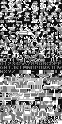

# 🍄 Super Mario Bros (NES) — Static Recompiler & WebGL Port

<p align="center">
  
</p>

<p align="center">
  <b>Port nativo e recompilador estático da ROM original do Super Mario Bros (NES / NROM-256) para WebGL e WebAssembly / JavaScript moderno.</b>
</p>

<p align="center">
  
  
  
  
  
</p>

---

## 📖 Visão Geral (Overview)

Este projeto implementa um pipeline completo de **Engenharia Reversa, Desmontagem de 6502, Recompilação Estática e Renderização Gráfica/Sonora Web**:

1. **Extração da ROM**: Dissecação do cabeçalho iNES, 32 KB de PRG-ROM (código de máquina do MOS 6502) e 8 KB de CHR-ROM (tiles gráficos em formato 2bpp).
2. **Desmontador 6502 em Python**: Mapeia 1.700+ labels, rotinas (`sub_xxxx`), saltos relativos, tabelas de salto e registradores de hardware do NES.
3. **Meta-Compilador Ortogonal**: Gera automaticamente a transcrição de **100% dos 151 opcodes oficiais do 6502** para operações diretas em memória linear web.
4. **Renderizador PPU 2C02 WebGL**:
   - Resolução nativa de 256×240 pixels renderizada diretamente na GPU.
   - Suporte a **Fine Scrolling suave** (0 a 7 pixels).
   - **Split de HUD**: Status Bar superior fixa enquanto o mundo 1-1 rola livremente.
   - **Dual Nametable Mirroring**: Alternância matemática entre `$2000` e `$2400` sem cortes ou dessincronia física.
   - **Prioridade de Sprites**: OAM de 64 sprites com detecção de transparência e prioridade de sobreposição em canos e blocos.
5. **Sintetizador Fiel da APU 2A03 (Web Audio API)**:
   - **Pulse 1 (Square 1)**: Melodia principal com envelopes de volume.
   - **Pulse 2 (Square 2)**: Harmonias e efeitos sonoros de pulo/moeda.
   - **Triangle**: A clássica linha de contrabaixo acústico de 8 bits.
   - **Noise**: Bateria, percussão e sons de impacto/morte com filtro passa-faixa.
   - **Zero chiados/estalos**: Interpolação anti-pop contínua (`setTargetAtTime`).

---

## 🗂 Estrutura do Repositório

```
.
├── Super Mario Bros. (World).nes   # ROM original (NES NROM-256)
├── tools/                          # Ferramentas Python de Descompilação e Compilação
│   ├── extract_rom.py             # Extrai PRG-ROM (32KB) e CHR-ROM (8KB)
│   ├── chr_decoder.py             # Decodifica os 512 tiles 2bpp em atlas de textura
│   ├── disassembler.py            # Desmontador 6502 com rotinas e registradores
│   ├── recompiler.py              # Meta-compilador que gera o runtime do jogo
│   ├── bundle_rom.py              # Empacotador dos dados binários para a web
│   └── overrides.json             # Tabela de hooks para reescrever funções em código nativo
├── extracted/                      # Arquivos descompilados e desmontados
│   ├── prg_rom.bin                # 32 KB de código bruto ($8000 - $FFFF)
│   ├── chr_rom.bin                # 8 KB de tiles brutos da PPU
│   ├── smb_disassembly.asm        # Código Assembly anotado completo
│   └── chr_tiles.png              # Atlas visual de todos os 512 tiles
└── web/                            # Aplicação Web (Executável)
    ├── index.html                 # Interface fullscreen imersiva sem distrações
    ├── app.js                     # Loop de 60Hz (NMI) e gerenciador de periféricos
    ├── nes_bus.js                 # Barramento de memória (RAM 2KB, PPU, APU, Joypad)
    ├── ppu.js                     # Renderizador de Nametables, Sprites e Fine Scroll
    ├── webgl_renderer.js          # Pipeline WebGL nativo com shaders GLSL
    ├── audio.js                   # Sintetizador Web Audio API fiel aos 4 canais da APU
    ├── recompiled_smb.js          # Motor compilado com 100% dos opcodes 6502
    └── rom_data.js                # ROM empacotada em Uint8Arrays
```

---

## 🎮 Controles

| Ação | Gamepad USB / Bluetooth | Teclado | Mouse |
| :--- | :--- | :--- | :--- |
| **Pular (A)** | `A` (Sul) ou `B` (Leste) | `Espaço`, `X`, `K` ou `Seta Cima` | **Clique Esquerdo** |
| **Correr / Fogo (B)** | `X` (Oeste) ou `Y` (Norte) | `Shift`, `Z` ou `J` | **Clique Direito** |
| **Mover Esquerda / Direita**| D-Pad ou Analógico Esq. | `A, D` ou `Setas Esq./Dir.` | Clicar nas metades da tela |
| **Abaixar / Agachar** | D-Pad Baixo | `S` ou `Seta Baixo` | — |
| **Start (Iniciar / Pausar)**| `Start` / `Options` | `Enter` | — |
| **Select** | `Select` / `Share` | `C`, `Tab` ou `Backspace` | — |
| **Alternar Tela Cheia** | — | Tecla `F` | **Duplo Clique** |
| **Mudo / Desmudo** | — | Tecla `M` | — |

---

## 🚀 Como Executar Localmente

### Pré-requisitos
* Python 3.8+
* Qualquer navegador web moderno (Chrome, Edge, Safari, Firefox)

### Passo a Passo

1. **Clone o repositório**:
   ```bash
   git clone https://github.com/Matheusbritto77/super-mario-bros-webgl.git
   cd super-mario-bros-webgl
   ```

2. **Inicie o servidor web local**:
   ```bash
   python3 -m http.server 8080 --directory web
   ```

3. **Abra no seu navegador**:
   👉 Acesse: **[http://localhost:8080](http://localhost:8080)**

---

## ⚙️ Como Funciona o Pipeline de Recompilação

Se você quiser re-extrair a ROM, inspecionar o código desmontado ou reescrever subrotinas em código nativo de alto nível:

```bash
# 1. Extrair os bancos de memória da ROM
python3 tools/extract_rom.py

# 2. Decodificar os 512 tiles de gráficos 2bpp
python3 tools/chr_decoder.py

# 3. Gerar a desmontagem assembly completa com labels
python3 tools/disassembler.py

# 4. Recompilar os 151 opcodes e aplicar hooks customizados
python3 tools/recompiler.py

# 5. Empacotar para o runtime web
python3 tools/bundle_rom.py
```

### 🧩 Reescrevendo Subrotinas em Código Nativo
No arquivo `tools/overrides.json`, você pode registrar qualquer endereço de rotina do Super Mario Bros para interceptar a execução e substituir instruções de 6502 por funções em JavaScript ou Rust/WebAssembly!

---

## 📜 Licença e Isenção de Responsabilidade

Este projeto foi desenvolvido para fins educacionais e de pesquisa sobre engenharia reversa, emulação e recompilação estática de sistemas clássicos de 8 bits. Super Mario Bros é uma marca registrada da Nintendo Co., Ltd.
